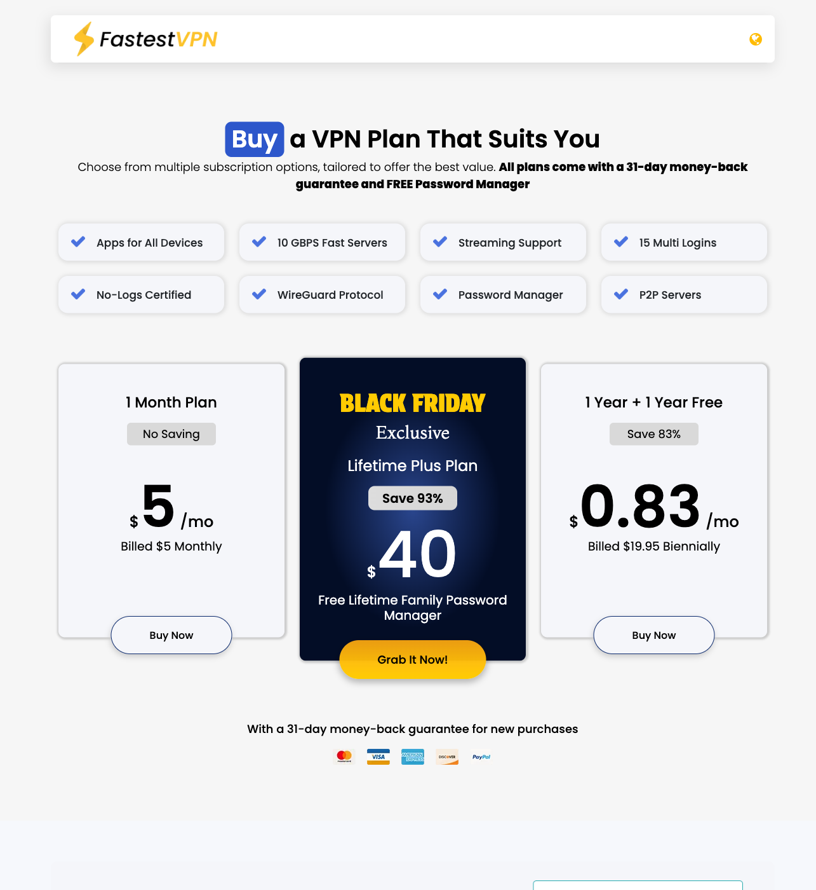

# FastestVPN 中文选购指南：低总价与 15 台设备值不值得买？

> **维护时间：2026-11-08 20:27 +08:00 · 公开价格核验日：2026-11-02 · 币种：美元**  
> 本文是基于已保存官网公开页面和政策资料整理的购买指南，不是中国大陆连通、速度、流媒体解锁、隐私或退款实测。本轮没有联网重新核价，也没有购买订阅。

> **联盟披露：**下方标注的 FastestVPN 购买链接是我们的自有联盟链接。若你通过它注册或付费，我们可能按 FastestVPN 的联盟规则获得佣金，通常不会增加你的购买价格。佣金关系不改变本文的适合/不适合判断。

## 先给结论

**适合考虑 FastestVPN 的人：**

- 想把账面总价压低，并愿意逐项核对最终账单、续费和附加项目；
- 家庭或多设备用户，正在比较官网页面所示的 **15 台同时连接**；
- 能阅读英文结账与退款条款，并愿意先验证自己的网络、设备和付款方式；
- 能接受“Lifetime”只是合同型商品名称，不把它理解成服务永久存在的保证。

**不适合直接购买的人：**

- 需要确定可在中国大陆稳定连接、保证解锁某个平台或需要中文客服的人；这些项目本稿都没有实测；
- 只看品牌名、WireGuard、`10 GBPS`、No-Logs 或审计徽章就要求速度与隐私结论的人；
- 不能接受英文支付页面、退款条件核对或附加费用的人；
- 想把账户任意转售或共享给不受控制第三方的人。页面写的是 15 台同时连接，本文不据此推导转售权。

## 怎么买：先选承诺长度，再核最终账单

1. **只想短期试用：**先看 $5 月付。它的前期现金承诺最低，但是否自动续费、税费和实际可用功能仍以结账页为准。
2. **明确愿意预付两年：**公开页面写的是 **$19.95 两年实付（billed biennially）**。这是一次收取的两年总价，**不是每月支付 $19.95**；页面折算月价也不代表按月扣款。
3. **考虑 Lifetime Plus：**公开页面显示 **$40 Lifetime Plus**。购买前应保存当时的服务范围、支持期限、续费与退款文字；“Lifetime”不等于商家永续经营或无限期无条件服务。
4. **需要额外功能：**专用 IP、端口转发等附加项目另计。不要把附加项目当作基础套餐已含，最终总价应以结账清单为准。
5. **付款前先验证：**确认自己的连接环境、设备应用、英文支付方式和完整条款。中国大陆适配尚未确认，本文不保证可连接、速度、解锁或付款成功。

> 图片只是 2026-11-02 保存的公开价格页面快照，不是本轮核价、付款记录或服务实测。

## 完整计费表

| 方案/项目 | 2026-11-02 公开页面所示 | 购买时必须再核对 |
|---|---:|---|
| 月付 | **$5 / 月** | 最终账单、税费、自动续费、包含功能和退款资格 |
| 两年 | **$19.95 两年实付** | 是两年期一次性账单，不是月付；核对续费价格与日期 |
| Lifetime Plus | **$40** | “Lifetime”的合同定义、服务范围、商家持续经营风险和退款条件 |
| 专用 IP / 端口转发等附加项目 | **另计** | 是否需要、单项价格、地区/平台限制及最终总价 |

这些数字只忠实转录 2026-11-02 的公开页面。折算月价可以帮助比较，但不能把两年账单改写成月付，也不能把截图当成 2026-11-08 的实时结账报价。

## 15 台设备意味着什么

官网页面写的是 **15 台同时连接**。它适合拿来评估家庭、多手机、电脑、电视或路由器场景的设备数量，但还需要逐台确认：

- 对应操作系统是否有可用应用；
- 所需协议和断线保护是否在该平台提供；
- 路由器连接如何计数；
- 账户共享、家庭范围和合理使用规则是什么。

本文没有同时连接 15 台设备，也不把该数字解释为任意转售、无限用户或每台设备体验相同。

## 性能、隐私与中国大陆适配边界

公开资料提到 WireGuard、`10 GBPS` 服务器、No-Logs 和审计信息。这些都只能作为下一步核查线索：

- **WireGuard** 是协议选项，不是本地速度结果；
- **10 GBPS** 是基础设施宣传，不是你的下载速度；
- **No-Logs** 是商家声明，不能替代对政策范围、账户数据和诊断数据的阅读；
- **审计徽章**不能替代报告范围、日期和完整结论；本稿未核阅底层报告；
- 本稿未测中国大陆连通、晚高峰、丢包、延迟、流媒体解锁、DNS/IP 泄漏或断线保护；
- 未确认中文客服、微信支付或支付宝，不能写成支持，也不能保证英文支付方式对每位用户可用。

如果你的核心需求是在中国大陆使用，应先用自己的 ISP、设备、目标地区和合法用途核连接；一个地区或一次成功都不能外推成长期保证。

## 31 天退款：这是条款承诺，不是退款实绩

公开页面宣传 **新购 31 天退款保证**。本文只把它记为商家条款承诺：我们没有购买、发起退款或收到退款，因而不能写“退款成功”或“无条件退款”。付款前应核对：

- 是否仅限首次新购；
- 不同支付方式或附加项目是否有排除项；
- 申请入口、时限、所需材料和到账方式；
- Lifetime Plus 与其他方案是否适用相同条件。

## 购买前的最小核对清单

- [ ] 保存方案名称、总收费、扣款周期、续费价和取消方式；
- [ ] 单列专用 IP、端口转发等附加项目，不漏算总价；
- [ ] 确认自己的设备、协议和同时连接计数；
- [ ] 用自己的连接环境测试，不把官网宣传当结果；
- [ ] 阅读退款适用范围，不把“31 天保证”当已成功退款；
- [ ] 仅在确认英文支付方式和本地法律要求后决定购买。

## 购买入口

<!-- AFF_SLOT:FASTESTVPN | 自有联盟链接；与英文稿使用同一签发原链接。 -->
**FastestVPN 方案 · 我们的联盟链接：**[查看 FastestVPN 当前购买选项](https://fststvpn.com/71cutgdggig8g)。

使用上方链接可能为我们带来佣金。本文没有购买或充值，也没有由佣金、待结算金额或实际到账反推产品表现。

## 最终建议

如果你追求**低账面总价、多设备上限**，并愿意自己核对连接、英文支付和退款条款，FastestVPN 值得放进候选：短期先比较 $5 月付，确定长期使用后再评估 $19.95 两年实付或 $40 Lifetime Plus。

如果你需要的是**已确认的中国大陆连通、中文客服、微信/支付宝、流媒体解锁或实测速度**，本稿没有足够证据支持购买结论。先验证这些硬条件，再决定是否付款；不要因为低价、品牌名或徽章跳过核对。
